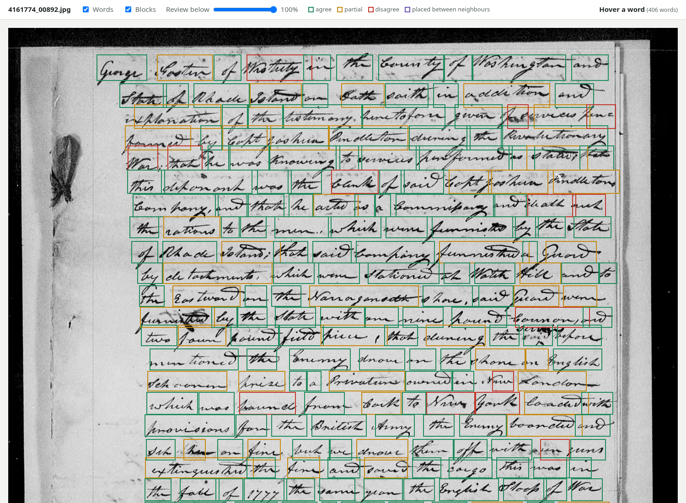

# indra_align

> **Proof of concept.** This is an experiment, not a finished tool. The code is a sketch and has not been tested broadly.

Test of whether the small [Indra OCR](https://pypi.org/project/indra-ocr/) model can supply **word-level bounding boxes** for text that was already transcribed by the larger, more accurate **Chandra** model.

## The idea

Chandra has already been run over the pages as **block-level** OCR: it gives a high-quality transcription for each text block, but only a bounding box for the whole block, not for individual words. Indra is smaller and less accurate, but it exposes line boxes and per-character x positions.

`chandra_indra_word_boxes.py` combines the two:

1. Run Indra on the page image to get lines and the x position of every recognized character.
2. For each Chandra block, collect the Indra lines that fall inside the block's bounding box.
3. Align Chandra's text to Indra's characters with a Levenshtein edit alignment (`rapidfuzz`).
4. Build a box for each Chandra word from the Indra characters it matched. Words that span a line break get one box per line. Words with no matched characters are placed between their neighbours and flagged as guessed.
5. Record how much of each word agrees exactly with Indra (`match`, 0–1). It works as a rough confidence score and points to words worth reviewing.

The result is Chandra's text with word-level geometry.

## Files

| File | Purpose |
| --- | --- |
| [grab_ocr_output.py](grab_ocr_output.py) | Fetches Chandra block-level OCR (text + bbox) for one page from the `RevolutionCrossroads/RevX_OCR_results` dataset on Hugging Face (via DuckDB). |
| [chandra_indra_word_boxes.py](chandra_indra_word_boxes.py) | Runs Indra, aligns it to the Chandra blocks, and writes word boxes as JSON, hOCR and/or an HTML viewer. |
| [indra_page_data.py](indra_page_data.py) | Runs Indra's full-page pipeline and writes `lines.csv`, `chars.csv` and `page.json`. |
| [align_indra_and_chandra.py](align_indra_and_chandra.py) | Newer aligner: uses the Indra CSVs (no Indra install needed), cuts Chandra's words into Indra lines with an edit-distance DP, then aligns characters within each line. Same outputs (`--html`, `--hocr`, JSON) plus an Indra-lines overlay. Estimates the Chandra→image scale automatically (`--scale` to override). |
| `4161774_00892.jpg` | Sample page image. |
| `page_63.json` | Sample Chandra block-level input. |
| `4161774_00892.words.json` | Sample word-box output. |
| `page.hocr` | Sample hOCR output. |
| `page.html` | Sample interactive HTML output (image embedded). |

## Usage

```bash
pip install indra-ocr rapidfuzz pillow numpy duckdb

# 1. Get Chandra block-level OCR for a page
python grab_ocr_output.py 196376039.pdf 62 -o page_63.json

# 2. Align it to Indra's geometry
python chandra_indra_word_boxes.py 4161774_00892.jpg page_63.json \
    --html page.html --hocr page.hocr
```

By default, the word-box JSON is written to `<image>.words.json`. Pass `--no-embed` to have the HTML link to the image instead of embedding it.

The blocks file is a list of `{"bbox": [x0, y0, x1, y1], "text": "..."}` objects, with the bbox in the pixel coordinates of the image.

## Sample output

`page.html` is an overlay viewer. Each word is boxed on the page image and colored by how well Chandra and Indra agreed. Hovering a word shows its text and agreement score, and the "Review below" slider dims everything above a chosen threshold so you can focus on the doubtful words.



Box colors:

- **Green**: Chandra and Indra agree on the word.
- **Orange**: partial agreement.
- **Red**: they disagree.
- **Purple, dashed**: no characters matched; the position was placed between neighbouring words.

Dashed gray outlines show the Chandra block boundaries.

## Known limitations

- Depends on Indra internals (`OrtOCR.detect_all` / `recognize`), which may change between releases. Pin your `indra-ocr` version.
- No deskew or rotation handling before Indra runs.
- Block bounding boxes are in the pixel space the page had during OCR, which may differ from the original image for resized PDFs.
- Word box widths are estimated from character positions plus padding, so they are approximate, especially on handwriting like the sample.
